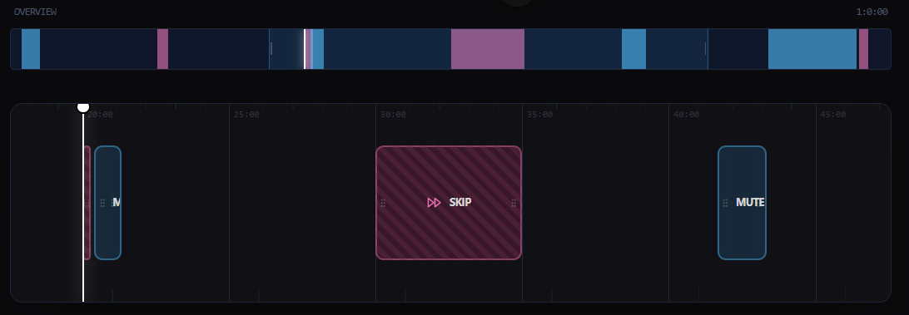

The enhanced timeline is designed for professional-grade precision while maintaining ease of use for long-form content. Here is a breakdown of the expected feature set:

### 1. Dual-Timeline Navigation
* **Overview Bar:** A high-level representation of the entire movie duration. It provides an instant "big picture" of where all edits are located (basically what the timeline is now).
* **Draggable Viewport:** A highlighted blue box on the Overview bar that can be dragged to pan the detailed view. Dropping the box leaves the view exactly where you placed it.
* **Click-to-Jump:** Clicking anywhere on the Overview bar instantly moves the playhead (scrubbing tick) and centers the detailed view on that specific timestamp.

### 2. Detailed Editing View
* **Variable Zoom:** Support for 1x to 20x magnification (via Ctrl + and Ctrl -), allowing you to move from viewing 10 minutes of footage to frame-accurate second-by-second views.
* **Dynamic Time Ticks:** Major and minor time-stamps that scale with the zoom level to provide constant temporal context.
* **Multi-Modal Scrolling:**
    * **Native Scroll:** Supports trackpad horizontal swiping and Shift + Scroll Wheel.
    * **Vertical-to-Horizontal Mapping:** Automatically translates regular vertical mouse wheel movement into horizontal scrolling for faster navigation.
* **Smart Auto-Panning:** The view automatically follows the playhead during playback or active scrubbing, but "unlocks" and stays stationary when you manually pan or scroll to inspect different parts of the movie.

### 3. Precision Segment Manipulation
* **Edge Resizing:** Interactive handles on the start and end of every segment. You can stretch or shrink segments with pixel-perfect accuracy that accounts for the current zoom level.
* **Minimum Visual Width:** A safety feature that ensures segments never shrink below 8px on screen. This prevents "ghost segments" (very short mutes or skips) from becoming unclickable at low zoom levels.
* **Visual Distinction:**
    * **Mute Segments:** Current blue color with speaker-off icons.
    * **Skip Segments:** Current pink color with a high-contrast diagonal stripe pattern, making them easily identifiable even for color-blind users.
* **Duration Constraints:** Built-in logic prevents segments from being "inverted" (start time exceeding end time) and maintains a minimum functional duration of 0.5 seconds.

### 4. Professional UI/UX
* **Bi-Directional Sync:** Changes in the detailed scroll position are reflected instantly in the Overview viewport and vice versa.
* **Feedback Loops:** Active resizing states include visual rings and higher z-index placement to show exactly which segment is being modified.

### Image for inspiration
